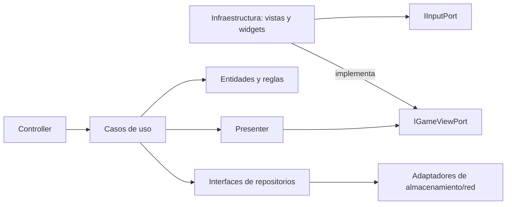

# Plan de estrategia - Arquitectura UI desacoplada

Estado: propuesta inicial  
Relacion: arquitectura base y especificacion de pantallas de `ui-context/`

## 1. Diagnostico de la arquitectura propuesta

La arquitectura propuesta es adecuada para HexaBlock, pero necesita tres precisiones antes de implementarla:

1. El dominio no puede depender de `IGameViewPort`; esa interfaz pertenece a la capa de presentacion.
2. `IGameViewPort` debe representar salida de presentacion, mientras que `IInputPort` representa entrada. La UI debe implementar el puerto de salida y comunicarse por el puerto de entrada.
3. El registro de modos debe elegir implementaciones en el composition root. El dominio conoce el contrato `IGameMode`, pero no la UI ni el framework concreto.

Separacion objetivo:



El Presenter no debe mutar entidades ni contener reglas de juego. El dominio debe rechazar movimientos invalidos y calcular el resultado. El Presenter solo formatea el resultado en un ViewModel.

## 2. Objetivo estrategico

Construir una aplicacion modular en la que se puedan agregar o retirar variantes sin modificar las vistas existentes.

Criterios de aceptacion generales:

- Ningun componente de UI importa entidades, casos de uso o implementaciones de modos.
- Cada accion visible se transforma en un comando o evento de entrada.
- Agregar un modo solo requiere registrar su fabrica, sus reglas y su configuracion de presentacion.
- Cambiar el framework o motor de interfaz no obliga a modificar el dominio.
- Las pantallas se pueden probar con ViewModels representativos sin motor ni red.
- Los requisitos y estados documentados siguen funcionando al cambiar de idioma.

## 3. Modelo comun por capas

### 3.1 Dominio

Contiene:

- Estado puro de partida.
- Entidades y objetos de valor.
- Regla comun de tablero y movimiento.
- Contratos genericos de motor y reglas.
- Casos de uso independientes de UI.
- Contratos de repositorio para progreso, niveles y configuracion.

Ejemplos de contratos:

- `GameEngine<TMove, TState>` para evolucionar una partida.
- `IGameMode` para indicar capacidad, reglas y configuracion de una variante.
- `StartGame`, `ApplyMove`, `Undo`, `Redo`, `Pause`, `Resume` como casos de uso.

La secuencia de desbloqueo, estrellas, movimientos y objetivos es decision de dominio, no de vista.

### 3.2 Presentacion

Contiene:

- Controllers para traducir eventos de UI a casos de uso.
- Presenters para traducir resultados a ViewModels.
- ViewModels simples, serializables y libres de framework.
- Estado de carga, normal, vacio y error.
- Un ViewModel compuesto para el HUD, tablero reservado, bandeja y controles.

La navegacion puede resolverse en la presentacion mediante resultados tipados. La vista no inspecciona la clase concreta del modo.

### 3.3 Infraestructura

Contiene:

- Vistas y widgets.
- Adaptadores de almacenamiento local.
- Adaptadores de red, cuando existan.
- Adaptadores de audio y configuracion regional.
- Implementaciones concretas de los modos y el composition root.

Cada pantalla declara sus datos recibidos y eventos emitidos, tal como hace la documentacion actual.

## 4. Modelo de modos

El `IGameMode` debe separar, como minimo:

- Identificador y metadatos.
- Tipo de entrada: partida directa o por niveles.
- Reglas del motor.
- Configuracion de HUD y controles.
- Creador de estado inicial y carga de nivel.

La UI solo recibe una descripcion de componentes. La configuracion puede incluir componentes como puntuacion, cronometro, movimientos, objetivos, bandeja, deshacer y rehacer. La vista interpreta una lista de descriptores y no nombres internos de variantes.

Ejemplo conceptual:

```text
ModeDescriptor
  id
  nameKey
  descriptionKey
  entryKind
  progressDescriptor
  hudComponents
  controls
```

El `GameModeRegistry` tiene dos responsabilidades:

- Registrar/describir modos disponibles.
- Crear un modo por identificador en el composition root.

El registro no contiene reglas ni decide que pantalla abre; solo publica metadatos y fabrica modos.

## 5. Estructura recomendada

Mientras no se elija tecnologia, conservar esta estructura conceptual:

```text
src/
  domain/
    entities/
    engine/
    modes/
    ports/
    usecases/
  application/
    controllers/
    presenters/
    viewmodels/
  infrastructure/
    ui/
    storage/
    network/
    audio/
  composition/
    registries/
    dependency-injection/
tests/
  domain/
  application/
  infrastructure/
  ui/
docs/
  architecture/
  ui-context/
```

La estructura exacta y el nombre de los modulos se adaptaran a la tecnologia elegida. Esta organizacion no debe sustituir los limites entre capas.

## 6. Implementacion por fases

### Fase 0 - Congelar decisiones y contratos

- Elegir lenguaje, framework de UI y motor de pruebas.
- Aprobar P-18, P-20, P-15, P-05, P-10, P-12 y P-14.
- Crear un diccionario de texto para español e inglés.
- Crear fixtures comunes de los cuatro modos.

Salida:

- Documento de decisiones.
- Contratos iniciales de entrada/salida.
- Datos de prueba reutilizables.

### Fase 1 - Montar el esqueleto desacoplado

- Crear entidades, ViewModels y puertos vacios.
- Implementar composer/composition root.
- Crear una pantalla neutra que pueda renderizar ViewModels y emitir eventos.
- Definir estados cargando, normal, vacio y error.

Salida:

- Prueba de que la UI puede funcionar sin el dominio real.
- Prueba de que el Presenter puede actualizar la UI sin conocer su framework.

### Fase 2 - Motor generico y progreso

- Implementar el tablero generico y sus representaciones.
- Extraer reglas compartidas.
- Implementar `IGameMode` con una variante piloto.
- Implementar progreso y desbloqueo en casos de uso.
- Conectar almacenamiento local.

Salida:

- Una partida completa de ejemplo con deshacer/rehacer si aplica.
- Persistencia verificable.

### Fase 3 - Componentes verticales

Implementar, en este orden, las pantallas indicadas por `00-indice.md`:

1. Sistema visual y componentes base.
2. Inicio.
3. Ajustes.
4. Seleccion de niveles.
5. Victoria y derrota.
6. Pausa.
7. Marco de partida.
8. Login y registro solo si P-18 se aprueba.

Cada pantalla se entrega con:

- ViewModel.
- Controller.
- Presenter.
- Estados documentados.
- Pruebas de acceso y eventos.
- Prueba sin ancho fijo de 360 px.

### Fase 4 - Modos completos

Integrar uno por uno:

1. Hexa Lines.
2. Hexa Merge.
3. Hexa Fit.
4. Hexa Sort.

Cada modo debe pasar las mismas pruebas de contrato antes de agregarse al registro.

### Fase 5 - Calidad, acceso y extensibilidad

- Agregar una prueba ficticia de quinto modo.
- Agregar una prueba con cero juegos y cero niveles.
- Verificar cambio de idioma sin reiniciar.
- Verificar que las decisiones importantes no dependen de color.
- Medir cobertura sobre dominio y presentacion.
- Ejecutar pruebas de UI solo para renderizado y eventos.

## 7. Plan de pruebas

### Dominio

- Movimientos validos e invalidos.
- Estado inicial y final.
- Victoria y derrota.
- Deshacer y rehacer.
- Objetivos y progreso.
- Desbloqueo secuencial o regla aprobada.
- Persistencia de progreso.

### Presentacion

- Transformacion de entidades a ViewModels.
- Generacion y omision de componentes segun el modo.
- Estados cargando, vacio y error.
- Conversion de eventos de UI a casos de uso.
- Navegacion segun tipo de entrada.

### UI

- Renderizado de fixtures.
- Extensibilidad con un quinto modo.
- Accesibilidad tactil.
- Espanol e ingles desde 360 px.
- Estados activos, desactivados y bloqueados.

No se debe ejecutar un motor real en una prueba de screenshot. Deben usar datos representativos y puertos de prueba.

## 8. Reglas de revision

Toda incorporacion debe comprobar:

- No hay referencias de UI dentro del dominio.
- El Presenter no conoce widgets.
- El caso de uso no conoce framework ni almacenamiento concreto.
- El Controller no aplica reglas de juego.
- La UI no contiene condiciones sobre `lines`, `fit`, `sort` o `merge`.
- Las ramas de variantes no estan escritas dentro de los componentes visuales.
- Los textos usan claves del catalogo.
- Agregar una fila de modo no requiere modificar el diseño de la pantalla.

## 9. Entregables y secuencia recomendada

Primera entrega:

1. Decision de tecnologia.
2. Contratos de dominio y puertos.
3. ViewModels comunes.
4. Registro minimo de modos.
5. Una vista compuesta que renderice el HUD configurado.

Segunda entrega:

1. Motor generico.
2. Almacenamiento de progreso.
3. Inicio y ajustes.
4. Seleccion de niveles.

Tercera entrega:

1. Las cuatro variantes.
2. Victoria, derrota y pausa.
3. Pruebas de extensibilidad.
4. Actualizacion de README y arquitectura.

## 10. Riesgos principales

| Riesgo | Mitigacion |
| --- | --- |
| La tecnologia impone demasiados detalles al dominio | Mantener puertos y contratos independientes de framework |
| El ViewModel se vuelve un modelo anemico o duplica entidades | Cada ViewModel debe incluir solo datos listos para presentacion |
| Las ramas por nombre vuelven a acoplar la UI | Usar descriptores y registro de modos |
| El tablero genera dependencias concretas | Separar geometria generica de representacion visual |
| Las decisiones pendientes se convierten en deuda | Registrar cada P-xx como hipotesis hasta que se aprueba |
| El UI kit se disena antes de los estados | Definir estados y eventos antes de estilos finales |

## 11. Definicion de terminado

El plan se considerara aplicado cuando:

- Las cuatro pantallas principales puedan usar datos de prueba sin motor.
- El dominio pueda ejecutar una partida sin referencias visuales.
- Los modos puedan agregarse sin modificar vistas existentes.
- Las acciones de usuario tengan una ruta completa hasta el caso de uso y el Presenter.
- Los tests de dominio, presentacion y UI esten separados.
- Las decisiones pendientes esten documentadas y no bloqueen el desarrollo del esqueleto.
