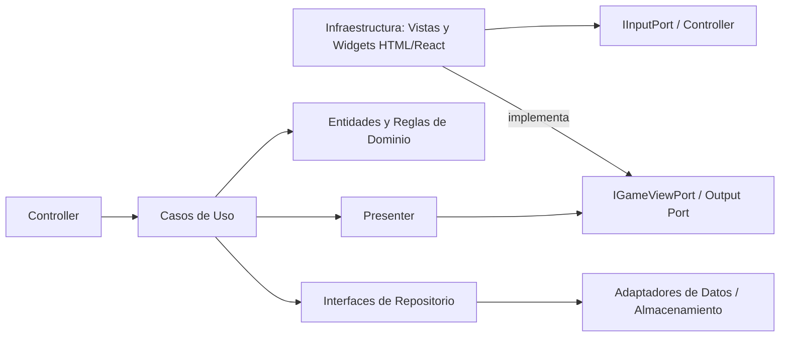

# Plan de Estrategia - Arquitectura UI Desacoplada (HexaBlock)

**Estado:** Aprobado / Especificación Maestra
**Relación:** Arquitectura base de cliente y especificación de pantallas (`docs/ui-context/`)

---

## 1. Diagnóstico de la Arquitectura Propuesta

La arquitectura de HexaBlock aplica **Clean Architecture** y **Principios SOLID**, con tres precisiones fundamentales:

1. **Aislamiento del Dominio:** El dominio no depende de `IGameViewPort`; esa interfaz pertenece a la capa de presentación (Output Port).
2. **Puertos de Entrada y Salida:**
   - `IInputPort` / `Controller`: Entradas que la UI invoca al capturar eventos de usuario.
   - `IOutputPort` / `IGameViewPort`: Salidas que la presentación emite y la UI implementa para renderizar ViewModels.
3. **Registro de Modos (Composition Root):** El registro de modos elige las implementaciones concretas en el `CompositionRoot`. El dominio conoce el contrato `IGameMode`, pero no la UI ni los frameworks visuales.

### Diagrama de Separación de Capas



> **Regla de Oro:** El Presenter no muta entidades ni contiene reglas de juego. El dominio rechaza movimientos inválidos y calcula el estado final. El Presenter solo convierte ese estado en un `ViewModel` deserializable.

---

## 2. Objetivo Estratégico y Criterios de Aceptación

Construir una aplicación modular en la que se puedan agregar o retirar variantes de juego (Hexa Lines, Merge, Fit, Sort) sin modificar las vistas existentes.

### Criterios de Aceptación Generales
- Ningún componente de UI importa entidades, casos de uso ni implementaciones de modos concretos.
- Cada acción visible del usuario se transforma en un comando de entrada (`IInputPort`).
- Agregar un nuevo modo de juego solo requiere registrar su fábrica, sus reglas y su configuración de presentación.
- Cambiar el framework visual (React, Canvas, DOM) no obliga a modificar el dominio.
- Las pantallas se pueden probar aisladas utilizando `ViewModels` de prueba (fixtures) sin motor ni red.
- Los estados y requisitos documentados siguen funcionando al cambiar de idioma dinámicamente.

---

## 3. Modelo Común por Capas

### 3.1 Dominio (`src/domain/`)
- Estado puro de la partida y tableros.
- Entidades y objetos de valor (ej. Coordenadas axiales, celdas).
- Reglas comunes de tablero y movimiento.
- Contratos genéricos de motor (`GameEngine<TMove, TState>`) e `IGameMode`.
- Casos de uso puramente independientes de UI (`StartGame`, `ApplyMove`, `Undo`, `Redo`).
- Contratos de repositorio para progreso, niveles y configuración.

### 3.2 Presentación (`src/adapters/presentation/`)
- `Controllers` para traducir eventos de UI a casos de uso.
- `Presenters` para traducir entidades a `ViewModels`.
- `ViewModels` simples, neutros y libres de framework.
- Manejo de estados: Carga, Normal, Vacío y Error.
- `ViewModel` compuesto para el HUD, tablero, bandeja de piezas y controles.

### 3.3 Infraestructura (`src/infrastructure/`)
- Vistas, componentes y renderizadores de pantalla (`BoardRenderer`).
- Adaptadores de almacenamiento local (`LocalStorage`, `AsyncStorage`).
- Adaptadores de red (`FetchHttpClient`, APIs REST, Gateways).
- Adaptadores de audio (`ExpoAudioPlayer`) y configuración regional/i18n.
- Punto de ensamble (`CompositionRoot`).

---

## 4. Modelo de Modos (Data-Driven UI)

El contrato `IGameMode` separa:
- Identificador y metadatos.
- Tipo de entrada: Partida directa o por niveles.
- Reglas del motor de juego.
- Configuración de componentes HUD y controles.
- Creador de estado inicial y cargador de niveles.

La UI solo recibe una lista de descriptores visuales (`ModeDescriptor`), interpretando qué widgets dibujar sin conocer nombres ni clases internas de variantes.

```typescript
export interface ModeDescriptor {
  id: string;
  nameKey: string;
  descriptionKey: string;
  entryKind: 'DIRECT' | 'LEVELS';
  progressDescriptor: string;
  hudComponents: string[];
  controls: string[];
}
```

El `GameModeRegistry` tiene dos responsabilidades:
1. Registrar y describir modos disponibles.
2. Fabricar la instancia del modo por su `id` en el `CompositionRoot`.

---

## 5. Fases de Implementación

```
┌────────────────────────────────────────────────────────┐
│ Fase 0: Congelar Decisiones y Contratos (Ports & DTOs) │
└───────────────────────────┬────────────────────────────┘
                            ▼
┌────────────────────────────────────────────────────────┐
│ Fase 1: Esqueleto Desacoplado & CompositionRoot        │
└───────────────────────────┬────────────────────────────┘
                            ▼
┌────────────────────────────────────────────────────────┐
│ Fase 2: Motor Genérico, Tablero Hexagonal y Progreso   │
└───────────────────────────┬────────────────────────────┘
                            ▼
┌────────────────────────────────────────────────────────┐
│ Fase 3: Componentes de UI Verticales (Pantallas Base) │
└───────────────────────────┬────────────────────────────┘
                            ▼
┌────────────────────────────────────────────────────────┐
│ Fase 4: Integración de Modos (Lines, Merge, Fit, Sort) │
└───────────────────────────┬────────────────────────────┘
                            ▼
┌────────────────────────────────────────────────────────┐
│ Fase 5: Pruebas de Extensibilidad y Calidad (SOLID)    │
└────────────────────────────────────────────────────────┘
```

---

## 6. Reglas de Revisión de Código (Checklist)

1. [ ] No existen referencias de UI dentro de `domain/` o `application/`.
2. [ ] El `Presenter` no importa ni conoce componentes de UI.
3. [ ] El Caso de Uso desconoce el framework de interfaz o almacenamiento.
4. [ ] El `Controller` no aplica ni valida reglas de juego (eso lo hace el Dominio).
5. [ ] La UI no contiene condicionales basados en cadenas como `'lines'`, `'fit'`, `'sort'` o `'merge'`.
6. [ ] Los textos e internacionalización usan claves de catálogo (`i18n`).