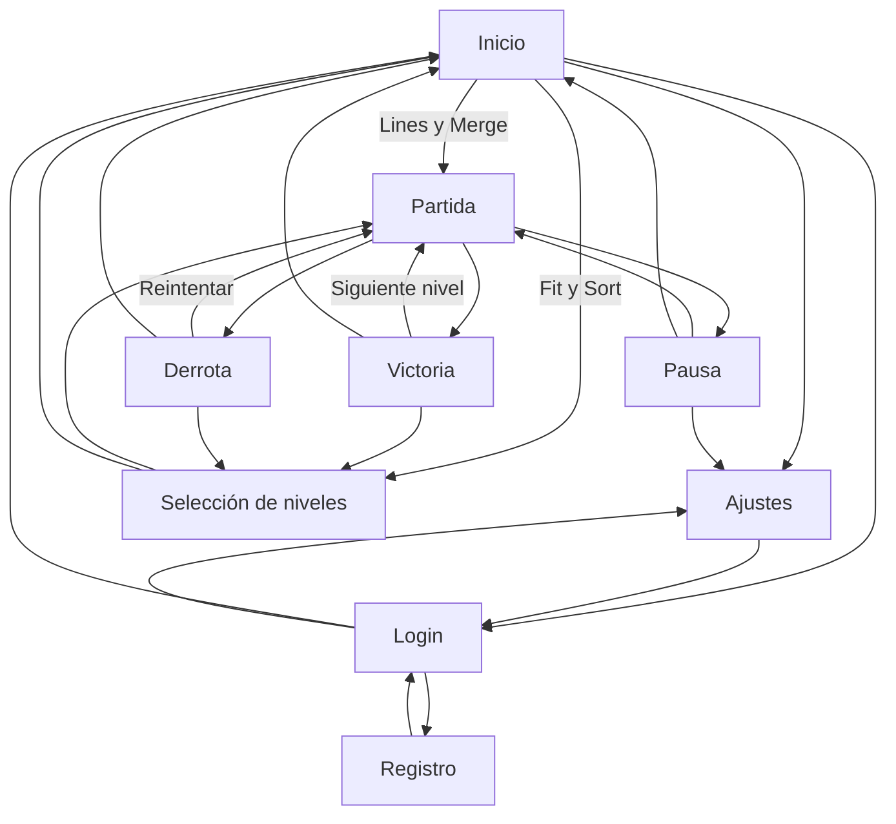

# HexaBlock Suite — Especificación de pantallas (frontend)

Versión 0.1 · 2026-11-01 · Deriva de la *Especificación de Requerimientos Funcionales* (IDs SUI, TAB, PRG, INT, BCK y puntos P-xx).

Estos archivos describen qué debe tener cada pantalla que se puede adelantar antes de definir arquitectura, patrones y diagramas. No eligen tecnología ni estructura de código.

## Pantallas incluidas

| # | Archivo | Pantalla | Estado | Requerimientos |
| --- | --- | --- | --- | --- |
| 01 | [`Inicio`](./01-inicio.md) | Inicio y selector de juego | Lista para diseñar | SUI-01, SUI-02, SUI-08, PRG-02 |
| 02 | [`Ajustes`](./02-ajustes.md) | Ajustes | Lista para diseñar (P-17) | SUI-03, SUI-04, SUI-05 |
| 03 | [`Login`](./03-login.md) | Inicio de sesión | Condicionada a P-18 y P-20 | INT-01, INT-02, INT-07, BCK-02 |
| 04 | [`Registro`](./04-registro.md) | Registro | Condicionada a P-18 y P-20 | INT-01, BCK-01 |
| 05 | [`Selección de niveles`](./05-seleccion-niveles.md) | Selección de niveles (Fit y Sort) | Lista para diseñar (P-15) | PRG-03, FIT-10, SUI-02 |
| 06 | [`Victoria`](./06-victoria.md) | Victoria | Lista para diseñar (P-05, P-10, P-12) | SUI-06, PRG-08 |
| 07 | [`Derrota`](./07-derrota.md) | Derrota | Lista para diseñar | SUI-07 |
| 08 | [`Pausa`](./08-pausa.md) | Pausa | Lista para diseñar (P-16) | SUI-09, SUI-10, SUI-08 |
| 09 | [`Partida`](./09-partida-marco.md) | Partida: solo marco y HUD, sin tablero | Solo mockup | TAB-03, TAB-10, TAB-11 |
| 10 | [`Textos`](./10-textos.md) | Textos en español e inglés | Lista | SUI-04 |

## Organización por pantalla

Las especificaciones funcionales viven directamente en este directorio:
`docs/specs/screens/<número>-<nombre>.md`.

Los recursos visuales y propuestas de diseño viven en
`docs/ui-context/screens/<número>-<nombre>/`. Para Inicio, el mockup y los
documentos visuales están separados del contrato funcional.

## Mapa de navegación

El destino al elegir un juego depende del **tipo** del juego (partida directa o por niveles), no de su nombre.

### Botón "atrás" del sistema

| Pantalla | Qué hace "atrás" |
| --- | --- |
| Inicio | Sale de la app |
| Ajustes | Vuelve a la pantalla de origen (Inicio o Pausa) |
| Login | Vuelve a la pantalla de origen (Inicio o Ajustes) |
| Registro | Vuelve a Login |
| Selección de niveles | Vuelve a Inicio |
| Partida | Abre la Pausa |
| Pausa | Reanuda la partida |
| Victoria | Selección de niveles (Fit y Sort) o Inicio (Merge) |
| Derrota | Selección de niveles (Sort) o Inicio (Lines y Merge) |

## Reglas comunes a todas las pantallas

1. **Pantalla sin lógica de negocio.** Solo muestra lo que recibe y avisa qué hizo el usuario. No contiene reglas de juego, no hace peticiones de red ni lee almacenamiento. Con datos de ejemplo debe poder verse y probarse sola.
2. **Cada pantalla declara tres cosas:** los datos que recibe, los eventos que emite y sus estados. Así se puede conectar después sin rehacerla.
3. **Listas dinámicas.** La lista de juegos y la de niveles se generan a partir de los datos. No se diseñan cuatro botones fijos ni 15 niveles fijos: el backend permite añadir niveles (5.2.4) y la extensibilidad exige poder añadir una quinta variante (3.1).
4. **Textos.** Ningún texto va escrito dentro de la pantalla: todos salen de [`10-textos.md`](./10-textos.md) por su clave. Cambiar de idioma no reinicia la app (SUI-04).
5. **Estados mínimos.** Toda pantalla que carga datos define sus estados de cargando, vacío, error y normal.
6. **Vía de regreso.** Desde cualquier pantalla hay un camino de vuelta al selector de juego (SUI-08).
7. **No depender solo del color.** Los estados (bloqueado, completado, error) llevan también icono o texto.
8. **Audio.** Los sonidos de la interfaz respetan el silencio de Ajustes (SUI-03).

### Supuestos de diseño (no vienen del enunciado)

- Orientación vertical, en teléfono. Las tabletas no son requisito.
- Objetivos táctiles de al menos 44 × 44 pt, y diseño válido desde 360 px de ancho.
- Las estrellas de Hexa Fit van de 1 a 3 (P-05).
- Los identificadores de ejemplo (`lines`, `fit`, `sort`, `merge`) son solo para los datos de prueba; el enunciado no define los valores de `gameId`.

## Orden de trabajo sugerido

1. **Sistema visual:** paleta, tipografía, iconos y componentes base (botón primario y secundario, tarjeta, interruptor, diálogo de confirmación, indicador de carga).
2. **Inicio → Ajustes → Selección de niveles → Victoria, Derrota y Pausa**, que son las que exige la lista mínima (5.1).
3. **Marco de Partida** como mockup, sin tablero.
4. **Login y Registro**, cuando se confirme P-18.

## Decisiones que bloquean o condicionan

| Pendiente | Afecta a | Qué hacer mientras tanto |
| --- | --- | --- |
| Elegir tecnología | Todo el código | Se puede diseñar en papel o en una herramienta de diseño |
| P-18: ¿cuentas y ranking entran en el alcance mínimo? | 03, 04 y el indicador de sesión de 01 y 02 | Diseñar, no implementar |
| P-20: campos del registro y reglas de contraseña | 03, 04 | Usar un único campo "usuario o correo" |
| P-17: contenido de ajustes | 02 | Dos interruptores (música y efectos) más el idioma |
| P-15: regla de desbloqueo de niveles | 05 | Suponer desbloqueo secuencial |
| P-05, P-10: puntuación de Fit y Sort | 06 | Mostrar bloques de resultado genéricos |
| P-12: Merge tras ganar | 06 | Dejar "Seguir jugando" como botón opcional |
| P-16: guardar partida a medias | 08 | Redactar las confirmaciones como si el avance se perdiera |

## Convenciones de estos archivos

- Cada elemento tiene un ID por pantalla (`INI-01`, `AJU-02`…) y una columna **Texto** con la clave de [`10-textos.md`](./10-textos.md).
- **Obligatorio** significa que viene del enunciado. **Opcional** o **Condicionado** significa que depende de una decisión pendiente.
- **Recibe** son los datos que la pantalla necesita para dibujarse. **Emite** son los avisos que da cuando el usuario actúa.
- Los valores entre llaves, como `{value}` o `{n}`, son marcadores que se rellenan al mostrar el texto.
