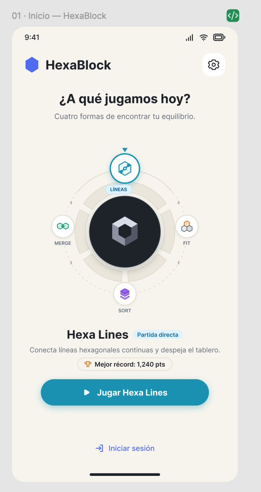

# Proposed design — Inicio

Status: Proposed
Source: attached 360 px visual reference

## Reference

The proposed design establishes the visual composition for Inicio, with a
light background, cream card surface and blue-violet interaction accents.

## Layout

1. Compact phone-status row inside the page mockup.
2. Header with the HexaBlock mark, the `app.title` text and the settings action.
3. Hero heading `¿A qué jugamos hoy?` and the supporting subtitle.
4. Hexagonal mode selector:
   - selected Lines mode at 12:00;
   - the selected mode is larger and more visually prominent;
   - the selected mode is surrounded by a cyan selection ring;
   - Merge at lower-left, Fit at lower-right and Sort at the bottom;
   - the center loads the preview resource identified by the selected descriptor;
   - both tap-to-select and drag/rotation gestures are supported;
   - selection changes animate the wheel, with or without a gesture.
5. Selected-mode card below the selector:
   - mode name;
   - entry-kind badge;
   - short description;
   - progress or best-score chip;
   - primary play button.
6. Session and ranking entry at the bottom.
7. Main content is placed inside a rounded mobile shell.

## Visual mapping

| Element | Existing token |
| --- | --- |
| Page background | `--color-bg` |
| Main shell and card surfaces | `--color-surface` |
| Primary title and mode name | `--color-text-primary` |
| Supporting text | `--color-text-secondary` |
| Primary action | `--color-primary` |
| Lines accent | `--color-game-lines` |
| Fit accent | `--color-game-fit` |
| Sort accent | `--color-game-sort` |
| Merge accent | `--color-game-merge` |
| Minimum interactive size | `--touch-target-min: 44px` |

## Behavior preserved from the specification

- Selecting a descriptor updates the detail card and entry-kind badge.
- A direct-entry mode opens the game.
- A level-entry mode opens level selection.
- Loading progress leaves all mode choices usable.
- Progress read failures show no progress summary and `home.error_progress`.
- An empty registry shows `home.empty`.
- The session control follows P-18: no session opens Login, and an active session
  identifies the player and exposes ranking access.
- The last selected mode is restored when returning to Inicio.
- Hexa Lines is the default only until the player has selected and persisted a mode.

## Open design decisions

- Final icon assets for the suite mark and four variants.
- Exact preview artwork for each variant in the local asset catalog.
